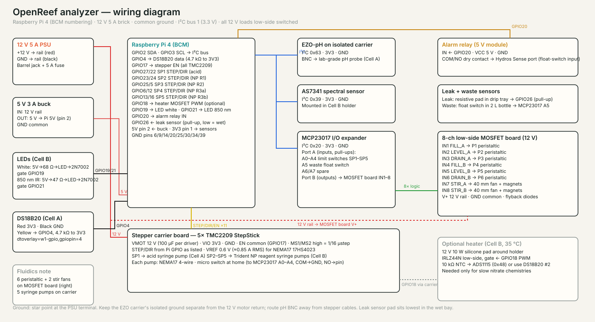

Source: `hardware/analyzer/cad/wiring.svg` (generated by `make_drawings.py`).

## Power tree

| Rail | Source | Loads |
|---|---|---|
| 12 V 5 A | external brick, fused | stepper drivers (VMOT), 6 peristaltic pumps, 2 stir fans, optional heater |
| 5 V 3 A | buck from 12 V | Raspberry Pi (pin 2/4), relay module, LEDs |
| 3.3 V | Pi pin 1 | EZO-pH carrier, AS7341, MCP23017, DS18B20, TMC2209 logic |

Star the grounds at the PSU terminal. The EZO carrier is galvanically isolated — leave its ground isolated from the 12 V return or pH will twitch whenever a pump runs.

## Raspberry Pi GPIO map (BCM)

| GPIO | Function | GPIO | Function |
|---|---|---|---|
| 2 / 3 | I²C SDA / SCL | 17 | Stepper EN (shared, active-low) |
| 4 | DS18B20 1-Wire | 27 / 22 | SP1 STEP / DIR — acid |
| 18 | Heater PWM (optional) | 23 / 24 | SP2 STEP / DIR — NP R1 |
| 19 | White LED gate | 25 / 5 | SP3 STEP / DIR — NP R2 |
| 21 | 850 nm LED gate | 6 / 12 | SP4 STEP / DIR — NP R3a |
| 20 | Alarm relay IN | 13 / 16 | SP5 STEP / DIR — NP R3b |
| 26 | Leak sensor (pull-up, low = wet) | | |

## MCP23017 (I²C 0x20)

| Pin | Function | Pin | Function |
|---|---|---|---|
| A0–A4 | Limit switches SP1–SP5 (NO to GND, internal pull-ups) | B0 | FILL_A |
| A5 | Waste float switch | B1 | LEVEL_A |
| A6, A7 | spare inputs | B2 | DRAIN_A |
| | | B3 | FILL_B |
| | | B4 | LEVEL_B |
| | | B5 | DRAIN_B |
| | | B6 | STIR_A |
| | | B7 | STIR_B |

Port B drives the eight MOSFET inputs (3.3 V logic is enough for IRLZ44N; for IRF520 boards add a 2N7002 level stage or use a board with optocouplers). Each pump gets a flyback diode if the board lacks them.

## Stepper carrier board

Perfboard with five StepStick sockets. Per driver: VMOT 12 V with 100 µF electrolytic, VIO 3.3 V, GND, EN common to GPIO17, MS1 and MS2 tied high (1/16 microsteps on TMC2209), STEP/DIR to the Pi pins above. Set VREF ≈ 0.6 V (≈0.85 A RMS) for 17HS4023 motors; they run cool at the duty cycle involved. Motor and switch leads on screw terminals or JST-XH.

## Sensors

- **EZO-pH** on the electrically isolated carrier board, I²C mode (default address 0x63). The software reads with temperature compensation (`RT,<temp>`) and exposes `Cal,mid/low/high` through the API.
- **AS7341** on the Adafruit STEMMA QT breakout, 0x39, gain 64×, ~50 ms integration, 16 samples averaged per reading; dark reading subtracted before each lit reading.
- **DS18B20** waterproof probe in Cell A, 4.7 kΩ pull-up, `dtoverlay=w1-gpio,gpiopin=4`.
- **Leak sensor**: any resistive water-detection module whose output goes low when wet, placed at the lowest point of the drip tray.
- **Waste float**: NC/NO float in the waste bottle lid, wired to close to GND when full.

## Alarm relay

A 5 V relay module driven from GPIO20 gives a dry contact (COM/NO). Wire it to a Hydros Sense port configured as a float-switch input, or to any controller's dry-contact input, and build rules there ("if OpenReef alarm, pause alk doser"). The relay closes on any `alert` (out-of-range result, leak, waste full, safety stop) and opens when all latest results are back in range.

## Optional heater

Nitrate chemistries developed at room temperature can take 30–45 minutes. A 12 V 10 W silicone heater pad wrapped around the Cell B holder with an IRLZ44N on GPIO18 (PWM) and a second DS18B20 or an NTC on an ADS1115 holds 35 °C and cuts development to about 10 minutes. Not needed for the Trident NP reagents at their default 25 minute development.
