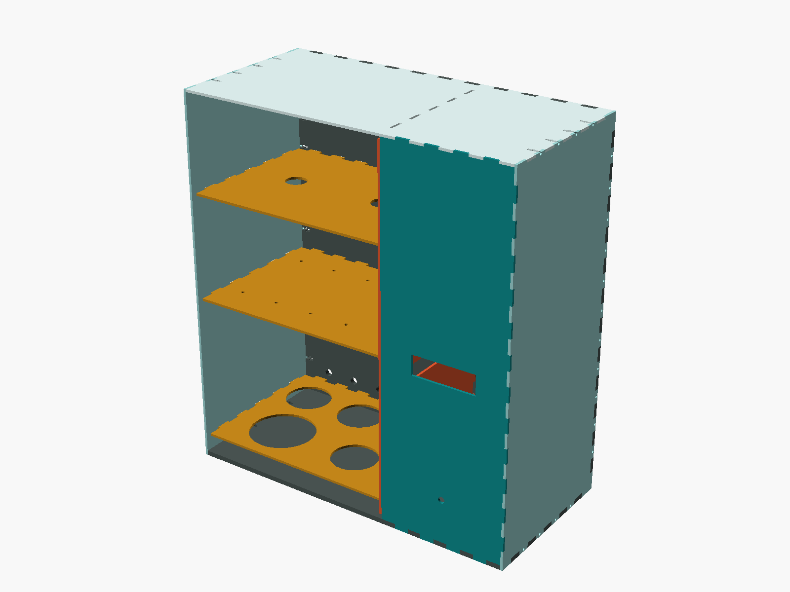
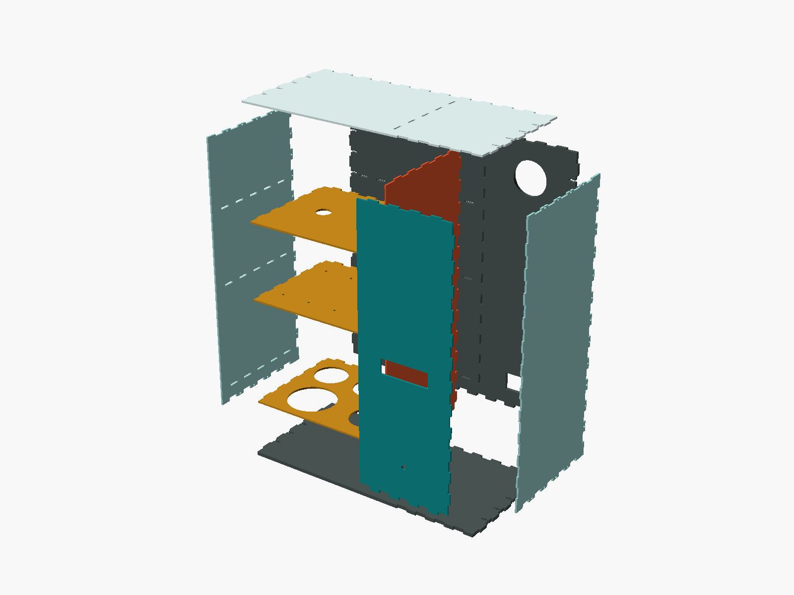
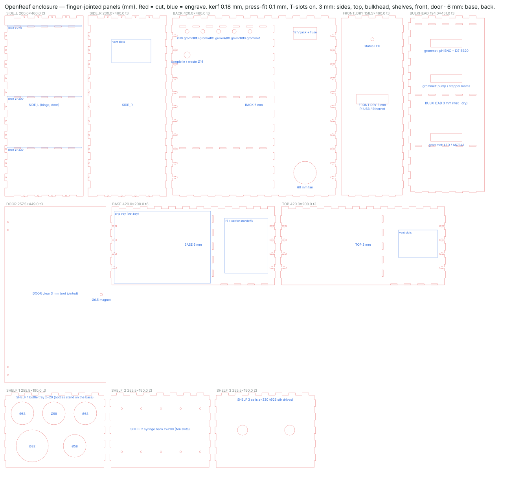
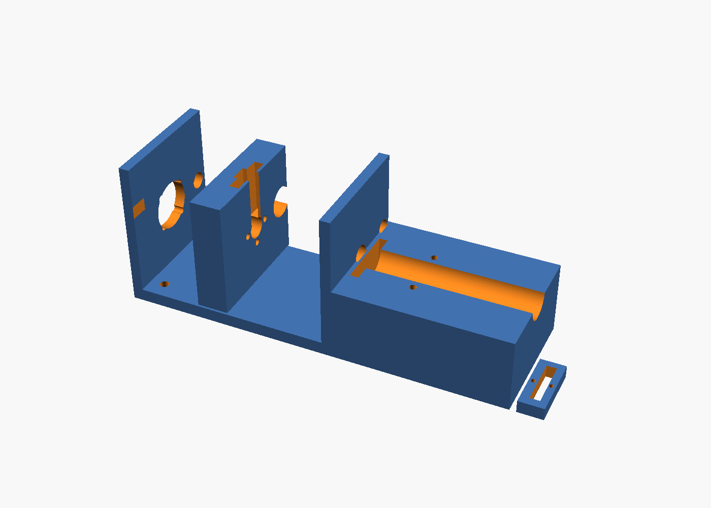
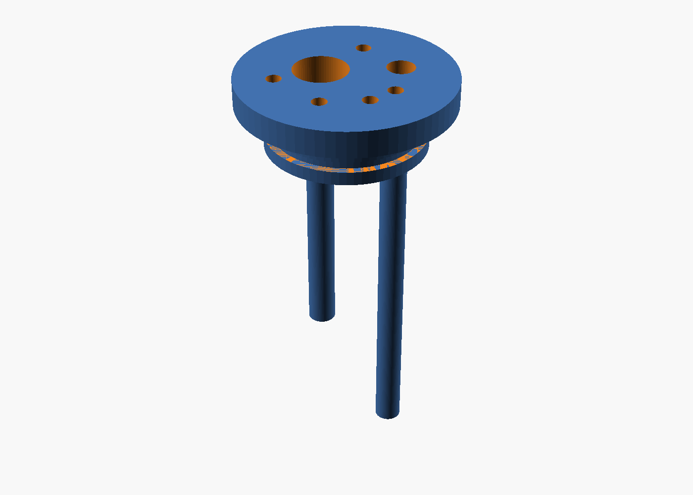
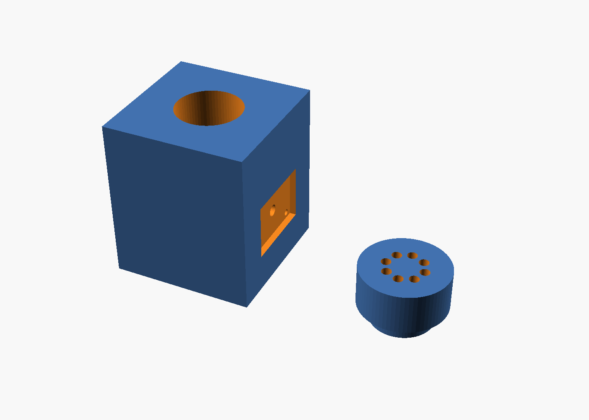

## Layout

Outer size 420 W × 460 H × 200 D mm. A full-height bulkhead splits a 260 mm **wet bay** (left) from a 160 mm **dry bay** (right). Electronics never share air with liquids; cables pass through grommets in the bulkhead above the highest liquid level.

```
 front view                                 side view
 ┌──────────────────────────┬────────────┐  ┌──────────────┐
 │ cells shelf   z=330      │ Pi + carrier│  │  door  │     │
 │  [Cell A] [Cell B]       │ MCP · MOSFET│  │        │ dry │
 ├──────────────────────────┤ relay       │  │  wet   │     │
 │ syringe pump bank z=200  │             │  │  bay   │ bay │
 │  [SP1][SP2][SP3][SP4][SP5]│ PSU in      │  │        │     │
 ├──────────────────────────┤ fan         │  │drip tray│    │
 │ bottle tray   z=20       │             │  └──────────────┘
 │  ○ ○ ○ ○ ○ (acid)        │             │
 └──────────────────────────┴────────────┘
    waste bottle below, outside
```

Peristaltic pumps mount on the wet face of the bulkhead so tube runs to both cells are short. The drip tray covers the whole wet-bay floor with the leak sensor at its low corner.

## Panels snap together



Every box edge is a **finger joint**: tabs on the base, back, top and dry-bay front panel land in notches on the two side panels; the back's bottom and top edges tab into the base and top. The bulkhead and the three shelves tab *through* slots in the base, back, top and side, so they lock the box square. Tab depth always equals the mating panel's thickness (3 or 6 mm), so joints finish flush.

The generator (`hardware/analyzer/cad/panels.py`) handles the fit:

| Parameter | Default | What it does |
|---|---|---|
| `--kerf` | 0.18 mm | your laser's kerf on 3 mm cast acrylic; measured on a test square |
| `--fit` | 0.10 mm | interference after kerf: tabs are widened and slots narrowed by this, so panels **press together and stay** during assembly |
| T-slots | on | a bolt channel and captive-nut pocket in every other gap of the long joints, with matching holes in the sides: M3 × 12 bolts make the hold permanent |

Cut a 30 mm test joint first and adjust `--kerf` until a tab needs a firm thumb push. Cast acrylic is brittle: keep `--fit` at or below 0.10 mm and rely on the T-slot bolts (or a bead of Weld-On 4 on the inside) rather than a tighter press fit, which cracks over months.

```bash
cd hardware/analyzer/cad
python panels.py --kerf 0.18 --fit 0.10 --out panels.svg      # cut file
python assembly.py && openscad -o enclosure_assembly.stl enclosure_assembly.scad   # 3D check / viewer
```



`panels.svg` is the cut file: red = cut, blue = engrave, 1 user unit = 1 mm (import at 100 % scale). Base and back are 6 mm; everything else 3 mm. The door is clear acrylic on two hinges with a magnet catch and is the only panel that is not jointed. The 16 printed corner brackets (`corner_bracket.scad`) are now optional — use them only if you cut the panels without T-slots.

Note on handedness: the panels are symmetric, so the same cut file builds the box with the wet bay on either side. Install the shelf-slotted side (`SIDE_L`) on the side you want the wet bay, with the engraved marks facing inward.

## Printed parts

| Part | File | Qty | Material | Notes |
|---|---|---|---|---|
| Syringe pump frame, carriage, plunger clip | `syringe_pump.scad` | 5 sets | PETG | 4 walls, 30 % infill |
| Cell A cap | `cell_a_cap.scad` | 1 | PETG | 100 % infill plug; 38 × 2 mm O-ring |
| Cell B holder body | `cell_b_holder.scad` (part="body") | 1 | **black** PETG | 100 % infill walls for light-tightness |
| Cell B lid | `cell_b_holder.scad` (part="lid") | 1 | PETG | |
| Corner bracket (optional) | `corner_bracket.scad` | 0–16 | PETG | only without T-slots |
| Stir drive mount | included in cell holder shelf cut-out | 2 | — | 40 mm fan + 2 magnets |

Set `part` at the top of each SCAD file to export individual STLs. The OpenSCAD files are parametric: syringe diameter, stroke, lead-screw pitch, cuvette diameter and tube diameters are variables at the top.

## Renders

| | | |
|---|---|---|
|  |  |  |
| Syringe pump: frame, carriage, plunger clip | Cell A cap with level and drain tube guides | Cell B light-tight holder and 8-port lid |

All renders are produced from the SCAD sources with `openscad -o renders/<part>.png --autocenter --viewall <part>.scad`.

## Assembly notes

- Dry-fit the box without the T-slot nuts first: base → back → bulkhead → shelves → sides → top → dry front. Tap tabs home with a rubber mallet through a wood block.
- Mount the bottle tray 20 mm above the base so spilled reagent runs into the drip tray, not under the tray.
- Route all tubing so that free ends are above liquid levels — no siphons.
- Put the 60 mm fan in the dry bay back panel blowing out; intake slots in the right side panel. The TMC2209 drivers barely warm up, but the PSU brick should stay outside.
- Label every tube at both ends before you close the door. Future you will thank you.
